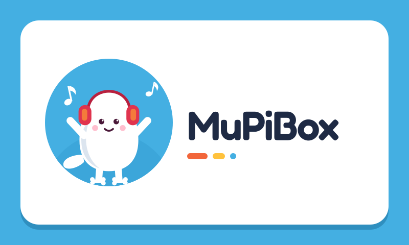

# MuPiBox
[](https://github.com/splitti/MuPiBox/releases)
[](https://github.com/splitti/MuPiBox/releases)
[](https://github.com/splitti/MuPiBox/issues)
[](https://discord.gg/4EjCgpCbbe) [](https://mupibox.de) [](https://www.youtube.com/channel/UCiqTXPBQLYgTB4uPBKzLENA) [](https://www.facebook.com/mupibox) [](https://paypal.me/DonateMuPiBox)

MuPiBox is an easy-to-use music player, controlled via touch display. You can use local music, Spotify and streams.



## Website & Support
For more information:
- visit https://mupibox.de 
- use our Discord-Channel https://discord.gg/4EjCgpCbbe
- see our Youtube-Channel: https://www.youtube.com/@mupibox

## Requirements
Please visit official website https://mupibox.de/anleitungen/installationsanleitung/was-wird-benoetigt/

## Known compatible hardware
Please visit official website https://mupibox.de/anleitungen/installationsanleitung/kompatible-hardware/

## How to install
Please visit official website  https://mupibox.de/anleitungen/installationsanleitung/einfache-installation/

## Spend a coffee via PayPal to
- <a href="https://paypal.me/EGerhardt" target="_blank">nero</a>
- <a href="https://paypal.me/splittscheid" target="_blank">splitti</a>

## Dependencies
See [DEPENDENCIES.md](DEPENDENCIES.md) for what MuPiBox needs (npm packages, system packages, binaries such as librespot, services) and what is no longer used.

## Based on
- DietPi (https://dietpi.com/)
- fbv by godspeed (https://github.com/godspeed1989/fbv)
- Initramfs Splash by DarkElevenAngel (https://gitlab.com/DarkElvenAngel/initramfs-splash)
- Sonos Kids Controller by Thyraz (https://github.com/Thyraz/Sonos-Kids-Controller)
- SpotifyController (https://github.com/amueller-tech/spotifycontroller)
- Librespot (https://github.com/librespot-org/librespot)
- pi-blaster by sarfata (https://github.com/sarfata/pi-blaster)
- google-tts by zlargon (https://github.com/zlargon/google-tts)
- Font Pan Pizza by Mark Lohner (https://www.marc-lohner.com/)
- Image by kirillslov (https://pixabay.com/de/vectors/katze-gehen-h%c3%b6ren-musik-kopfh%c3%b6rer-5775898/)
- Startup-Sound by Zeraora (https://freesound.org/people/Zeraora/sounds/572773/)
- Shutdown-Sound by Leszek_Szary (https://freesound.org/people/Leszek_Szary/sounds/133283/)
- WLED by Discord-User ronbal and ChatGPT
- jq (https://github.com/jqlang/jq/releases)
- Icons are from https://github.com/Templarian/MaterialDesign

## Cover Flow prompt
[docs/COVERFLOW_PROMPT.md](docs/COVERFLOW_PROMPT.md) is a prompt for an AI coding assistant that rebuilds the Cover Flow theme of this fork in your own MuPiBox project.

## Contributing
All contributions, e.g. reporting issues, are welcome.

### What is where
- `src/frontend-box` – the display UI (Angular + Ionic), what the kids see on the touch screen.
- `src/backend-api` – the Node/Express API (port 8200). It also serves
  - **the MuPiBox app** at `/app` (`src/backend-api/src/mupi-app`): plain JavaScript, no build step.
    It replaces the admin interface page by page and is where most new features go.
  - the manual at `/manual` (`src/backend-api/src/manual`).
- `src/backend-player` – the player (mpv and Spotify, port 5005).
- `AdminInterface/www` – the old PHP admin interface, kept for the pages the app does not have yet.
- `scripts`, `config`, `autosetup`, `update` – what runs on the box itself (DietPi).

### Local development
Develop in a GitHub codespace (`.devcontainer`) or locally with Node.js 22 (PHP 8 only for the admin interface).

1. Fork this repository and run `npm install` in the root folder once.
2. Copy the config templates (the box's own `mupiboxconfig.json` too: without it the display does not know its
   theme and draws the plain layout, and the app's pages answer 503), and give the display an "online" network
   state (on a box the network check writes it; without it the display shows radio as unavailable and never starts
   its Spotify player):
   `cp config/templates/www.json src/backend-api/config/config.json && cp config/templates/monitor.json config/templates/mupiboxconfig.json src/backend-api/config/`
   `echo '{"onlinestate":"online","ip":"127.0.0.1"}' > src/backend-api/config/network.json`
3. `npm run serve:backend-api` and open http://localhost:8200/app/ – the app, served straight from
   `src/backend-api/src/mupi-app` (edit, reload). Away from a box, pages that need its hardware or
   config show no data. `npm run serve:frontend-box` for the display UI (http://localhost:4200; it proxies `/api`
   to the backend and takes its theme from `src/frontend-box/src/dev/active_theme.css`, change the theme there),
   `npm run serve:admin` for the admin interface (http://127.0.0.1:8000), `npm run serve` for all of them.
   Your own box's library and settings: take the two files out of a backup of the box (Settings › Backup) into
   that folder, `unzip -o -j <backup>.zip etc/mupibox/mupiboxconfig.json home/dietpi/.mupibox/Sonos-Kids-Controller-master/server/config/data.json -d src/backend-api/config/`
   (the app's own restore page works on a box only). The Spotify client id and secret go into `config.json` by hand.
4. `npm run lint` (Biome) before you commit. Tests: `npm run test:frontend-box` and
   `npm run test --workspace=mupibox-backend-api`.
5. Create a branch, commit, push and open a pull request.

### Testing a change on a box
The installer and the update install from the zips in the repository (`bin/nodejs/deploy.zip`,
`AdminInterface/release/www.zip`), not from the source. That is also how a public branch is tested on a box:

```shell
cd; curl -L https://raw.githubusercontent.com/<your-github-username>/MuPiBox/<branch>/update/start_mupibox_update.sh \
| sudo bash -s -- branch <branch> <your-github-username>/MuPiBox
```

So a pull request should include rebuilt zips, as its **last, separate commit** ("deploy.zip neu gebaut"),
built from a clean checkout of the branch (`git status` empty, then `cd src && ./deploy.sh` for the Node
parts and the app, `AdminInterface/zip.sh` for the admin interface). Keep source changes and the zip
commit apart: zips do not merge, and the maintainers may drop and redo that commit when they merge.
Other build output (`src/deploy/`, `src/frontend-box/www/`) stays out of the repository.

While you work, copying the built files over the installed ones is faster than a full update (ssh as
`dietpi`; the Node bundles live in `~/.mupibox/Sonos-Kids-Controller-master`, the player in
`~/.mupibox/spotifycontroller-main`). The next update puts the released files back. Copy with rsync, which
sends only the files that changed (`sudo apt install rsync` on the box once if it is missing), or
with scp. For the app, from the repository root:

```shell
rsync -av src/backend-api/src/mupi-app/ dietpi@<box>:.mupibox/Sonos-Kids-Controller-master/mupi-app/
# or
scp -r src/backend-api/src/mupi-app/* dietpi@<box>:.mupibox/Sonos-Kids-Controller-master/mupi-app/
```

The other folders and files below go over the same way (`rsync -av <local>/ dietpi@<box>:<remote>/` for a
folder, `scp <file> dietpi@<box>:<remote>` for a single file).

- **App** (`src/backend-api/src/mupi-app`):
  - copy the folder's files to `~/.mupibox/Sonos-Kids-Controller-master/mupi-app/` and reload `http://<box>/app/`.
  - No build, no restart.
- **Backend**:
  - `npm run build:backend-api`
  - copy `src/deploy/server.js` to `~/.mupibox/Sonos-Kids-Controller-master/server.js`
  - then `pm2 restart server` (the manual from `src/deploy/manual/` goes to `.../manual/` the same way).
- **Player**:
  - `npm run build:backend-player`
  - copy `src/deploy/spotify-control.js` to `~/.mupibox/spotifycontroller-main/spotify-control.js`
  - then `pm2 restart spotify-control`
- **Display UI**:
  - `npm run build:frontend-box`
  - copy the files of `src/deploy/www/browser/` into `~/.mupibox/Sonos-Kids-Controller-master/www/`
    (leave `active_theme.css`, `cover`, `rss-covers` and `theme-data` as they are)
  - then `/usr/local/bin/mupibox/restart_kiosk.sh`.
- **Admin interface**:
  - copy the changed files of `AdminInterface/www/` to `/var/www/` (owned by `www-data`, so with `sudo`).

The app's texts are German in the source; the translations live in
`src/backend-api/src/mupi-app/i18n/<lang>.json` (at least `en.json`). Add a line to `news.txt` for a change
users will notice.

Without a box, the Dockerfile in the root directory gives a production-like test of freshly built zips: it
installs `bin/nodejs/deploy.zip` and `AdminInterface/release/www.zip` the way autosetup does (Node 22, pm2,
lighttpd with PHP and the proxy to the app). `npm run docker:build`, then `npm run docker:start`; the app is at
http://localhost/app/, the old admin interface at http://localhost/index.php, the display UI at http://localhost:8200/
(with the player beside it on port 5005, as the kiosk on a box has it; from another device in the network the
display goes through the API instead, as a phone does). There is no sound device and no hardware in the container:
Spotify plays (the display plays it in the browser, see below), while radio, local files, NAS and podcasts run through
mpv inside the container and stay silent; the WiFi, GPIO and display pages do not work. A backup of your own box
(Settings › Backup) can be
restored into the container, on the app's Backup page or with `docker cp backup.zip mupibox:/tmp/` and
`docker exec mupibox unzip -o /tmp/backup.zip -d /`; then `docker exec mupibox /usr/local/bin/mupibox/setting_update.sh`
(carries the Spotify login into the servers' configs) and `docker restart mupibox`. Spotify then plays through the
display at http://localhost:8200/ in a browser with Widevine (Chrome, Edge, Safari) and comes out of your computer.
